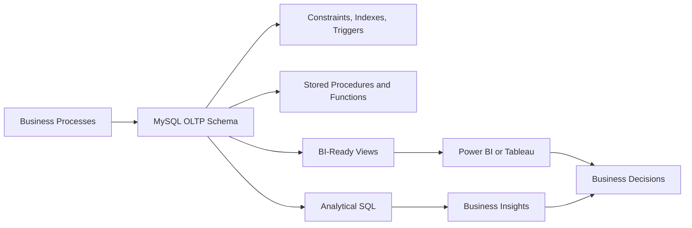

# NovaMart Analytics

**Enterprise Sales, Customer & Business Intelligence SQL Database**

[](https://www.mysql.com/)
[](https://en.wikipedia.org/wiki/SQL)
[](#analytics-capabilities)
[](#key-features)
[](#bi-integration)

NovaMart Analytics is an enterprise-style MySQL project that models the
operations of a fictional e-commerce and retail company. It combines a
normalized operational schema, generated transactional data, database
automation, BI-ready views, and analytical SQL.

The current seed procedure generates **500 products, 10,000 customers, and
50,000 orders** across multiple warehouses. The design also represents
suppliers, employees, payments, shipments, returns, marketing campaigns,
customer reviews, and inventory. The dataset is synthetic and intended for
portfolio demonstration, SQL practice, and BI prototyping rather than
production reporting.

The project demonstrates the journey from **business problem** to
**relational model**, **data generation**, **SQL processing**, **advanced
analytics**, and **business decision support**.

## Table of Contents

- [Overview](#overview)
- [Business Problem](#business-problem)
- [Project Objectives](#project-objectives)
- [Architecture](#architecture)
- [Database Domains](#database-domains)
- [Technology Stack](#technology-stack)
- [Key Features](#key-features)
- [Analytics Capabilities](#analytics-capabilities)
- [Repository Structure](#repository-structure)
- [Prerequisites](#prerequisites)
- [Installation](#installation)
- [Clone Instructions](#clone-instructions)
- [Database Setup](#database-setup)
- [Running the Project](#running-the-project)
- [Exploring the Database](#exploring-the-database)
- [BI Integration](#bi-integration)
- [Questions This Database Can Answer](#questions-this-database-can-answer)
- [Data Quality](#data-quality)
- [Performance Optimization](#performance-optimization)
- [Skills Demonstrated](#skills-demonstrated)
- [Business Value](#business-value)
- [Why This Project Matters](#why-this-project-matters)
- [Interview Talking Points](#interview-talking-points)
- [Scalability](#scalability)
- [Future Improvements](#future-improvements)
- [Project Learning Outcomes](#project-learning-outcomes)
- [Portfolio Value](#portfolio-value)
- [Author](#author)
- [License](#license)

## Overview

NovaMart represents a realistic retail data environment in which:

- Customers place orders for products.
- Products belong to categories and brands.
- Products are stocked across warehouses and supplied by vendors.
- Order items determine revenue, discounts, and product-level profitability.
- Payments, shipments, returns, and reviews provide the surrounding
  operational context.
- Employees can be associated with departments, orders, and warehouse
  operations.
- Marketing campaigns and customer interactions support acquisition analysis.

The database is intentionally designed to support both operational workflows
and analytical questions. It gives analysts a consistent relational foundation
instead of treating every report as an isolated spreadsheet.

## Business Problem

A growing e-commerce organization needs more than a list of transactions. It
needs reliable answers to questions such as:

- Which products and categories generate the most revenue and profit?
- Which customers create the most long-term value?
- Which customers are at risk of becoming inactive?
- Which acquisition channels and campaigns perform best?
- Where are inventory shortages developing?
- Which warehouse has the strongest operational performance?
- How long do deliveries take?
- Which products have unusually high return rates?
- How are revenue and order values changing over time?

Raw transactional records do not answer these questions directly. NovaMart
provides the schema, relationships, database logic, and analytical queries
needed to turn transactions into business insight.

## Project Objectives

The project aims to:

1. Model realistic retail and e-commerce processes.
2. Use a normalized relational design with clear ownership of data.
3. Enforce integrity through keys, constraints, and relationships.
4. Generate repeatable synthetic data for development and analysis.
5. Automate inventory and order-related rules in the database.
6. Support customer, product, sales, marketing, and operations analytics.
7. Provide reusable views for BI tools.
8. Demonstrate transactions and rollback-safe order processing.
9. Prepare a foundation that can scale toward a warehouse architecture.
10. Show how technical SQL work connects to business decisions.

## Architecture

The project follows an operational-first design with an analytical access
layer:



### OLTP layer

The normalized operational layer stores customers, orders, order items,
products, inventory, payments, shipments, returns, and related entities. It
is designed around transactional consistency and referential integrity.

### Analytical layer

Views and analytical queries provide reporting-friendly access to monthly
sales, customer lifetime value, product performance, customer segmentation,
cohort retention, Pareto contribution, and growth trends. These objects make
the operational data easier to consume without duplicating every business
calculation in a dashboard.

For a production deployment, the analytical layer could be moved to a
separate warehouse or reporting database so heavy aggregations do not compete
with live order processing.

## Database Domains

| Domain | Purpose |
|---|---|
| Employee | Departments, managers, and operational ownership |
| Customer | Profiles, status, segmentation, and addresses |
| Product | Catalog, categories, brands, pricing, and status |
| Supplier | Procurement contacts, ratings, and product sourcing |
| Inventory | Warehouse stock, reservations, and movements |
| Sales | Orders, order items, discounts, and totals |
| Payment | Payment methods, statuses, and transaction references |
| Shipping | Providers, tracking, delivery status, and costs |
| Returns | Return requests, items, conditions, and refunds |
| Reviews | Customer ratings and product feedback |
| Marketing | Campaigns, customer interactions, and acquisition costs |

## Technology Stack

| Technology | Role |
|---|---|
| MySQL 8+ | Relational database engine and SQL runtime |
| SQL | Data definition, automation, reporting, and analytics |
| Git | Version control for schema and analytical changes |
| GitHub | Collaboration, documentation, and portfolio delivery |
| Power BI | Optional dashboard and semantic reporting layer |
| Tableau | Optional alternative visualization layer |
| Python or Jupyter | Optional extension for ingestion and advanced analysis |

## Key Features

### Database design

- Third-normal-form relational structure for core operational entities
- Primary keys, foreign keys, unique constraints, and check constraints
- Self-referencing employee and category relationships
- Composite keys for many-to-many relationships
- Explicit status and lifecycle fields for operational records

### Database engineering

- Indexes for common joins, filters, and date-based analysis
- Views for reusable BI datasets
- Stored procedures for seed-data generation and order placement
- A reusable profit-margin function
- Triggers for order-item totals and inventory movement
- Transaction handling with rollback behavior for failed order placement

### SQL capability

- Multi-table joins and conditional aggregation
- Common table expressions
- Window functions and ranking
- Date arithmetic and period analysis
- Correlated subqueries
- CASE-based segmentation and classification
- Revenue, cost, margin, and return calculations

## Analytics Capabilities

### Sales analytics

The project supports monthly revenue, order volume, units sold, average order
value, category performance, product rankings, month-over-month change, and
year-over-year comparisons.

### Customer analytics

Customer reporting includes lifetime value, recency-frequency-monetary (RFM)
segmentation, cohort retention, repeat-purchase behavior, customer status,
and acquisition-channel analysis.

### Product analytics

Product views support revenue, units sold, unit cost, gross profit, margin,
rankings, return rate, and ABC/Pareto classification.

### Marketing analytics

Campaign and customer-interaction records provide a foundation for conversion
rate, acquisition cost, channel performance, and campaign ROI reporting.

### Operations analytics

Inventory and fulfillment data can be used to study stock levels, reservations,
reorder alerts, warehouse activity, delivery performance, cancellations, and
returns.

## Repository Structure

```text
sql/
├── README.md
├── 01_schema_setup.sql
├── 02_triggers_functions.sql
├── 03_data_generation.sql
├── 04_views_bi.sql
└── 05_analytics.sql
```

| File | Responsibility |
|---|---|
| `01_schema_setup.sql` | Recreates the database, tables, relationships, and indexes |
| `02_triggers_functions.sql` | Adds the margin function and inventory/order triggers |
| `03_data_generation.sql` | Creates the synthetic catalog, customers, orders, items, and payments |
| `04_views_bi.sql` | Defines reusable sales, CLV, and product-performance views |
| `05_analytics.sql` | Runs advanced analysis and defines the transactional order procedure |
| `README.md` | Documents setup, execution, architecture, and usage |

## Prerequisites

Required:

- MySQL Server 8.0 or later
- MySQL Workbench, MySQL Shell, or another MySQL-compatible client
- Git, if cloning from GitHub

Optional:

- Power BI Desktop
- Tableau Public or Tableau Desktop
- Python and Jupyter for extensions beyond the SQL project

## Installation

1. Install MySQL 8.0+.
2. Start the MySQL service.
3. Confirm that your client can connect to the server.
4. Download or clone this repository.
5. Open the `sql` directory in your SQL IDE.

Do not commit database passwords or other credentials to the repository.

## Clone Instructions

Replace the placeholder with the repository URL:

```bash
git clone <REPOSITORY_URL>
cd <REPOSITORY_DIRECTORY>
```

Then open the `sql` folder in MySQL Workbench, VS Code with SQLTools, or your
preferred SQL client.

## Database Setup

Execute the files in this dependency order:

1. `01_schema_setup.sql`
2. `02_triggers_functions.sql`
3. `03_data_generation.sql`
4. `04_views_bi.sql`
5. `05_analytics.sql`

The order matters:

- The schema must exist before functions, triggers, or procedures reference it.
- Functions and triggers must exist before generated orders exercise their
  logic.
- Views depend on tables and the profit-margin function.
- Analytical queries depend on generated data and the views.

The schema setup script intentionally recreates the `novamart_analytics`
database. Run it only when resetting a development environment; it is
destructive to an existing database with that name.

## Running the Project

### MySQL Workbench

1. Create a local MySQL connection.
2. Open the first script in the SQL editor.
3. Execute each file in the documented order.
4. Review the output and object list after each stage.
5. Open the analytical script last to inspect the result sets.

### MySQL command line

Connect to your local MySQL instance using your normal credentials, then
execute each script in sequence from the client. The exact command varies by
operating system and installation location, so keep credentials outside shell
history where possible.

### VS Code with SQLTools

Install the SQLTools extension and its MySQL/MariaDB driver, create a
connection to the local server, and run the five files in order. Select the
connection before executing statements.

### Troubleshooting

- **Version mismatch:** Use MySQL 8.0+ because the project uses CTEs and window
  functions.
- **Foreign-key errors:** Confirm that the schema script completed before
  running dependent files.
- **Existing database:** The first script resets the development database.
  Export anything important before rerunning it.
- **Access denied:** Verify the host, port, user, and password in the client.
- **Slow seed generation:** The generator inserts thousands of related rows.
  Allow time for completion and check the server log if it stops unexpectedly.
- **Encoding problems:** Use a UTF-8 connection and verify the client
  connection character set.

## Exploring the Database

After execution, inspect the database in this order:

1. Review tables and foreign-key relationships.
2. Check row counts in the customer, product, order, and order-item tables.
3. Inspect indexes and table definitions.
4. Review the stored procedures, function, and triggers.
5. Query the BI views.
6. Run analytical sections individually and compare the results with the
   business question they address.

Use the schema script as the structural reference and the view/analytics
scripts as the reporting reference. In a larger project, add a data
dictionary and ER diagram alongside these files.

## BI Integration

Connect Power BI or Tableau to MySQL using a read-only reporting user in a
shared environment. For a local portfolio setup, the default MySQL connector
is sufficient.

Recommended dashboard pages include:

### Executive dashboard

- Revenue and profit
- Orders and customers
- Average order value
- Margin
- Revenue trend

### Sales dashboard

- Monthly revenue
- Product and category performance
- Geographic or warehouse performance
- Units sold and order status

### Customer dashboard

- RFM segments
- Customer lifetime value
- Cohort retention
- Repeat-purchase behavior

### Operations dashboard

- Inventory on hand
- Reserved inventory
- Reorder candidates
- Returns and delivery performance

### Marketing dashboard

- Campaign reach and conversion
- Acquisition cost
- Revenue by channel
- Customer interactions

Use SQL for preparation, governed business logic, and reusable measures. Use
Power BI or Tableau for exploration, visualization, filtering, and sharing.

## Questions This Database Can Answer

1. What is total revenue by period?
2. How is monthly revenue changing?
3. Which products generate the most revenue?
4. Which products generate the highest gross profit?
5. Which categories have the strongest margins?
6. Who are the highest-value customers?
7. Which customers are at risk of churn?
8. What is the customer lifetime value distribution?
9. What is the repeat-customer rate?
10. Which acquisition channels produce valuable customers?
11. Which marketing campaigns have the strongest conversion?
12. What is the cost of acquiring customers by channel?
13. Which products have the highest return rates?
14. Which warehouses have the most inventory?
15. Which products are below their reorder level?
16. What is the average order value?
17. Which products account for most revenue under Pareto analysis?
18. How do customer cohorts retain over time?
19. Which orders are cancelled, returned, or delayed?
20. What is the relationship between product price, units sold, and margin?
21. Which brands contribute most to revenue?
22. How do payment methods and statuses vary by order volume?
23. Which suppliers support the most important products?
24. How could inventory and fulfillment be improved?

## Data Quality

The relational design supports validation of:

- Duplicate customer and product identifiers
- Missing required fields
- Invalid email or contact values
- Negative prices, costs, quantities, or inventory
- Broken foreign-key relationships
- Invalid order totals and line totals
- Payment totals that do not reconcile with orders
- Inventory reservations that exceed available stock
- Ratings outside the supported range
- Returns that exceed purchased quantities

Synthetic data generation is useful for development, but it should not be
treated as production-quality data. A production implementation would add
formal profiling, validation reports, ingestion monitoring, and remediation
workflows.

## Performance Optimization

The project demonstrates foundational performance practices:

- Indexes on status, date, foreign-key, and frequently joined columns
- Composite indexes for common filter combinations
- Reusable views for reporting logic
- Aggregation at the appropriate business grain
- CTEs and window functions for analytical transformations
- `EXPLAIN` as the starting point for query tuning

At larger volumes, analytical workloads should be separated from live
transactions through a warehouse, replicated reporting database, summary
tables, or an appropriate orchestration strategy.

## Skills Demonstrated

| Skill | Demonstrated through |
|---|---|
| SQL | Joins, CTEs, window functions, aggregation, and date logic |
| Data modeling | Normalized entities and business relationships |
| Data quality | Constraints, validation concepts, and reconciliation checks |
| Business analysis | KPIs and questions tied to retail decisions |
| Customer analytics | RFM, cohort retention, and lifetime value |
| Product analytics | Revenue, margin, ranking, and return analysis |
| BI | Reusable views and dashboard-ready datasets |
| Database engineering | Indexes, triggers, procedures, functions, and transactions |
| Data engineering | Structured generation and dependency-aware execution |
| Problem solving | Translating business questions into measurable outputs |

## Business Value

The database gives a retail team a shared analytical foundation. Instead of
building disconnected reports, teams can define revenue, customer value,
inventory, and margin logic against consistent relationships.

The resulting workflow is:

```text
Business Problem
      ↓
Database Architecture
      ↓
Data Collection / Generation
      ↓
Data Modeling
      ↓
SQL Processing
      ↓
Advanced Analytics
      ↓
Business Insights
      ↓
Power BI / Tableau
      ↓
Business Decisions
```

## Why This Project Matters

A professional Data Analyst does not only write isolated `SELECT` statements.
They need to understand business processes, data relationships, quality,
metrics, analytical trade-offs, visualization, and decision-making.

NovaMart demonstrates how those concerns connect. The same pattern appears in
e-commerce, banking, SaaS, logistics, healthcare, telecom, manufacturing, and
FinTech: operational systems capture events, analysts structure and validate
the data, and BI consumers use trusted metrics to act.

## Interview Talking Points

This project supports discussion of:

- Why the core schema is normalized
- How foreign keys protect relationships
- When indexes help and when they add write cost
- The difference between OLTP and OLAP workloads
- Why BI views are useful
- How RFM and lifetime value are calculated conceptually
- How returns affect revenue and product metrics
- How inventory consistency is maintained with triggers and transactions
- How window functions support ranking and period comparisons
- How the design could scale to millions of orders
- How incremental ingestion and reporting refreshes would be handled
- How Power BI or Tableau would consume the reporting layer

## Scalability

The current project is intentionally sized for local execution. To scale from
50,000 orders toward 10 million or more, consider:

- Partitioning large fact-like tables by date
- Reviewing indexes with actual workload plans
- Separating reporting reads through replicas
- Moving analytical workloads to a cloud warehouse
- Adding incremental ETL or ELT pipelines
- Introducing dimensional models and governed metric layers
- Building summary tables for high-traffic dashboards
- Orchestrating data quality and refresh jobs
- Adding monitoring for load times, failures, and data freshness

These are architectural options, not claims that they are already implemented
in this repository.

## Future Improvements

Potential next steps include:

- Automated Python ingestion and validation
- Airflow or another orchestration layer
- A cloud-hosted MySQL or warehouse deployment
- A dimensional warehouse model
- dbt transformations and tests
- Automated Power BI refresh
- Sales forecasting
- Churn prediction
- Product recommendations
- Real-time inventory events
- A formal data dictionary and ER diagram
- CI checks for SQL formatting and object dependencies

## Project Learning Outcomes

### Beginner

- SQL fundamentals
- Relational relationships
- Joins and aggregations
- Basic business metrics

### Intermediate

- CTEs and window functions
- Views and indexes
- Stored procedures and functions
- Constraint-based data integrity

### Advanced

- Operational data modeling
- RFM and cohort analysis
- Query performance thinking
- Transactional automation
- BI architecture
- Translating business questions into analytical definitions

## Portfolio Value

NovaMart is designed to demonstrate more than basic SQL syntax. It shows
enterprise-style schema thinking, analytical reasoning, data quality
awareness, database automation, performance considerations, and BI readiness.

For a recruiter or hiring manager, the repository provides a concrete way to
evaluate how a candidate moves from a business problem to a structured data
solution and then to measurable insight.

## Author

**Priyam Paul**

Focus areas:

- Data Analytics
- SQL
- Business Intelligence
- Data Engineering
- Machine Learning

Links:


- LinkedIn: `<www.linkedin.com/in/priyam-paul-024795262>`


